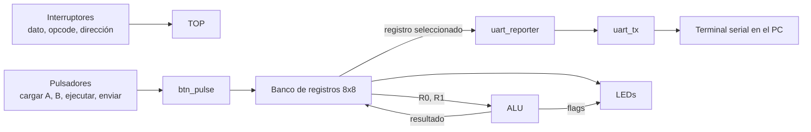

# arquitecturaDeProcesadoresG1E1

Arquitectura de Procesadores - Grupo 1 Equipo 1


## Integrantes
* [David Orlando Torres](https://github.com/davidortorresto-lab) 

* [Luis Cuervo ](https://github.com/luis-cuervo)

## 1. Introducción

La ALU y el banco de registros son los bloques centrales del *datapath* de un procesador: el primero ejecuta las operaciones aritméticas y lógicas, y el segundo almacena de forma temporal operandos y resultados. En esta práctica se implementa un banco de registros de 8 × 8 bits conectado a una ALU de 8 bits, se integran en un módulo `top` controlado con interruptores y pulsadores, y se construye un sistema de visualización que envía el contenido de cualquier registro por UART hacia un terminal serial en el PC.

## 2. Objetivos

- Comprender el funcionamiento de la ALU y del banco de registros como bloques fundamentales de la microarquitectura de un procesador.
- Implementar un módulo de banco de registros para almacenar operandos y resultados, facilitando el flujo de datos.
- Desarrollar un sistema de visualización para monitorear los datos almacenados en el banco de registros.
- Corroborar el funcionamiento del proyecto mediante su implementación en la FPGA.

## 3. Marco teórico

### 3.1 ALU

La ALU es el bloque del procesador que realiza las operaciones matemáticas y lógicas básicas (suma, resta, AND, OR, XOR, NOT y desplazamientos). Está conectada a los registros dentro del datapath y, además del resultado, produce *flags* de estado que describen la operación (cero, acarreo, desbordamiento y signo).

### 3.2 Banco de registros

El banco de registros es un conjunto de registros de acceso rápido que guarda datos y resultados intermedios. Típicamente tiene una o más puertas de lectura combinacionales y una puerta de escritura síncrona habilitada por una señal `we`. Aquí se usa un banco de 8 registros de 8 bits (dirección de 3 bits).

### 3.3 UART

UART (*Universal Asynchronous Receiver-Transmitter*) es un protocolo de comunicación serial asíncrona. No usa un reloj compartido: emisor y receptor acuerdan previamente la velocidad (*baud rate*, por ejemplo 9600 o 115200 baudios). Usa dos líneas unidireccionales, **TX** y **RX**, y es *full-duplex*.

Una trama 8N1 consta de un bit de inicio (0), 8 bits de datos (LSB primero), sin paridad y un bit de parada (1). La línea en reposo permanece en 1.

Para generar la velocidad a partir del reloj de la FPGA se cuenta un número de ciclos por bit:

`CLKS_PER_BIT = CLK_FREQ / BAUD = 50 000 000 / 115 200 ≈ 434`

El error resultante (≈ 0,006 %) es despreciable. [Ajustar si la tarjeta usa un reloj distinto de 50 MHz.]

## 4. Diseño

### 4.1 Arquitectura general



[Insertar aquí el diagrama de bloques propio si el docente lo solicita.]

### 4.2 ALU

Entradas `a` y `b` de 8 bits, `opcode` de 3 bits y `carry_in`. Salidas: `y` (8 bits) y los flags `zero`, `carry_out`, `overflow` y `negative`.

| Opcode | Operación | Descripción |
|---|---|---|
| `000` | ADD | `y = a + b + cin` |
| `001` | SUB | `y = a - b` (`carry_out` indica *borrow*) |
| `010` | AND | `y = a & b` |
| `011` | OR | `y = a \| b` |
| `100` | XOR | `y = a ^ b` |
| `101` | NOT | `y = ~a` |
| `110` | SHL | desplazamiento a la izquierda; `carry_out = a[7]` |
| `111` | SHR | desplazamiento a la derecha; `carry_out = a[0]` |

> Ajustar la tabla a las operaciones y codificación de la ALU construida en el laboratorio anterior.

Flags: `zero = (y == 0)`, `negative = y[7]`, `overflow` en complemento a dos para ADD y SUB.

### 4.3 Banco de registros

8 registros de 8 bits, una puerta de escritura síncrona (`we`, `addr_w`, `din`) y tres puertas de lectura combinacionales: `addr_a` y `addr_b` alimentan la ALU, y `addr_d` alimenta la visualización. Convención de uso en este diseño:

| Registro | Contenido |
|---|---|
| R0 | Operando A |
| R1 | Operando B |
| R2 | Resultado de la ALU |
| R3–R7 | Disponibles |

### 4.4 Control con interruptores y pulsadores

| Entrada | Función |
|---|---|
| `sw[7:0]` | Dato de entrada |
| `sw[10:8]` | Opcode de la ALU |
| `sw[13:11]` | Registro a visualizar |
| `sw[14]` | `carry_in` |
| `key_n[0]` | Carga `sw[7:0]` en R0 (operando A) |
| `key_n[1]` | Carga `sw[7:0]` en R1 (operando B) |
| `key_n[2]` | Ejecuta la ALU y guarda el resultado en R2 (y actualiza los flags) |
| `key_n[3]` | Envía por UART el registro seleccionado |
| `rst_n` | Reinicio |

Los pulsadores son activos en bajo; cada uno pasa por un sincronizador, un filtro antirrebote y un detector de flanco (`btn_pulse`) que genera un pulso de un ciclo.

### 4.5 Sistema de visualización

- **LEDs:** muestran el valor del registro seleccionado por `sw[13:11]`, y cuatro LEDs adicionales muestran los flags de la última operación (`N V C Z`).
- **UART:** al pulsar `key_n[3]`, el módulo `uart_reporter` envía una línea de 7 caracteres con la dirección y el valor en hexadecimal, por ejemplo `R2=3F` seguido de retorno de carro y salto de línea. Esto cubre la visualización opcional de la dirección.

## 5. Descripción en Verilog

Estructura del repositorio:

```
src/  alu.v  regfile.v  btn_pulse.v  uart_tx.v  uart_reporter.v  top.v
tb/   top_tb.v
docs/img/  (capturas)
```

### 5.1 `src/alu.v`

```verilog
module alu (
    input  [7:0] a,
    input  [7:0] b,
    input  [2:0] opcode,
    input        cin,
    output reg [7:0] y,
    output       zero,
    output reg   carry_out,
    output reg   overflow,
    output       negative
);
    reg [8:0] t;
    always @(*) begin
        t = 9'd0; y = 8'd0; carry_out = 1'b0; overflow = 1'b0;
        case (opcode)
            3'b000: begin
                t = a + b + cin; y = t[7:0]; carry_out = t[8];
                overflow = (a[7] == b[7]) && (y[7] != a[7]);
            end
            3'b001: begin
                t = {1'b0, a} - {1'b0, b}; y = t[7:0]; carry_out = t[8];
                overflow = (a[7] != b[7]) && (y[7] != a[7]);
            end
            3'b010: y = a & b;
            3'b011: y = a | b;
            3'b100: y = a ^ b;
            3'b101: y = ~a;
            3'b110: begin y = {a[6:0], 1'b0}; carry_out = a[7]; end
            3'b111: begin y = {1'b0, a[7:1]}; carry_out = a[0]; end
        endcase
    end
    assign zero     = (y == 8'd0);
    assign negative = y[7];
endmodule
```

### 5.2 `src/regfile.v`

```verilog
module regfile (
    input        clk,
    input        rst,
    input        we,
    input  [2:0] addr_w,
    input  [7:0] din,
    input  [2:0] addr_a,
    input  [2:0] addr_b,
    input  [2:0] addr_d,
    output [7:0] dout_a,
    output [7:0] dout_b,
    output [7:0] dout_d
);
    reg [7:0] mem [0:7];
    integer i;

    always @(posedge clk or posedge rst) begin
        if (rst) begin
            for (i = 0; i < 8; i = i + 1) mem[i] <= 8'd0;
        end else if (we) begin
            mem[addr_w] <= din;
        end
    end

    assign dout_a = mem[addr_a];
    assign dout_b = mem[addr_b];
    assign dout_d = mem[addr_d];
endmodule
```

### 5.3 `src/btn_pulse.v`

```verilog
module btn_pulse #(parameter DEB = 500_000) (   // 10 ms a 50 MHz
    input      clk,
    input      rst,
    input      btn,       // activo en alto
    output reg pulse
);
    reg s0, s1, stable;
    reg [19:0] cnt;

    always @(posedge clk or posedge rst) begin
        if (rst) begin
            s0 <= 0; s1 <= 0; stable <= 0; cnt <= 0; pulse <= 0;
        end else begin
            s0 <= btn; s1 <= s0; pulse <= 0;
            if (s1 != stable) begin
                if (cnt == DEB - 1) begin
                    cnt <= 0; stable <= s1; pulse <= s1;
                end else cnt <= cnt + 1;
            end else cnt <= 0;
        end
    end
endmodule
```

### 5.4 `src/uart_tx.v`

```verilog
module uart_tx #(parameter CLK_FREQ = 50_000_000, parameter BAUD = 115200) (
    input        clk,
    input        rst,
    input        start,
    input  [7:0] data,
    output reg   tx,
    output       busy
);
    localparam CPB = CLK_FREQ / BAUD;
    localparam IDLE = 2'd0, START = 2'd1, DATA = 2'd2, STOP = 2'd3;

    reg [1:0]  st;
    reg [15:0] cnt;
    reg [2:0]  idx;
    reg [7:0]  sh;

    assign busy = (st != IDLE);

    always @(posedge clk or posedge rst) begin
        if (rst) begin
            st <= IDLE; tx <= 1'b1; cnt <= 0; idx <= 0; sh <= 0;
        end else begin
            case (st)
                IDLE: begin
                    tx <= 1'b1; cnt <= 0; idx <= 0;
                    if (start) begin sh <= data; st <= START; end
                end
                START: begin
                    tx <= 1'b0;
                    if (cnt == CPB - 1) begin cnt <= 0; st <= DATA; end
                    else cnt <= cnt + 1;
                end
                DATA: begin
                    tx <= sh[idx];
                    if (cnt == CPB - 1) begin
                        cnt <= 0;
                        if (idx == 3'd7) st <= STOP;
                        else idx <= idx + 1;
                    end else cnt <= cnt + 1;
                end
                STOP: begin
                    tx <= 1'b1;
                    if (cnt == CPB - 1) begin cnt <= 0; st <= IDLE; end
                    else cnt <= cnt + 1;
                end
            endcase
        end
    end
endmodule
```

### 5.5 `src/uart_reporter.v`

```verilog
// Envía "R<addr>=<HH>\r\n" (7 bytes) cuando llega el pulso send.
module uart_reporter #(parameter CLK_FREQ = 50_000_000, parameter BAUD = 115200) (
    input        clk,
    input        rst,
    input        send,
    input  [2:0] addr,
    input  [7:0] data,
    output       tx,
    output       busy
);
    reg  [7:0] d;
    reg  [2:0] a, idx;
    reg        active, tx_start;
    reg  [7:0] tx_data, msg;
    wire       tx_busy;

    uart_tx #(.CLK_FREQ(CLK_FREQ), .BAUD(BAUD)) u_tx (
        .clk(clk), .rst(rst), .start(tx_start), .data(tx_data),
        .tx(tx), .busy(tx_busy));

    function [7:0] hex;
        input [3:0] n;
        hex = (n < 4'd10) ? (8'h30 + n) : (8'h37 + n);
    endfunction

    always @(*) begin
        case (idx)
            3'd0:    msg = "R";
            3'd1:    msg = 8'h30 + a;
            3'd2:    msg = "=";
            3'd3:    msg = hex(d[7:4]);
            3'd4:    msg = hex(d[3:0]);
            3'd5:    msg = 8'h0D;      // CR
            default: msg = 8'h0A;      // LF
        endcase
    end

    assign busy = active;

    always @(posedge clk or posedge rst) begin
        if (rst) begin
            active <= 0; idx <= 0; tx_start <= 0; tx_data <= 0; a <= 0; d <= 0;
        end else begin
            tx_start <= 1'b0;
            if (!active) begin
                if (send) begin a <= addr; d <= data; idx <= 0; active <= 1; end
            end else if (!tx_busy && !tx_start) begin
                if (idx == 3'd7) active <= 1'b0;
                else begin
                    tx_start <= 1'b1; tx_data <= msg; idx <= idx + 1;
                end
            end
        end
    end
endmodule
```

### 5.6 `src/top.v`

```verilog
module top #(
    parameter CLK_FREQ = 50_000_000,
    parameter BAUD     = 115200,
    parameter DEB      = 500_000
) (
    input         clk,
    input         rst_n,
    input  [3:0]  key_n,      // pulsadores activos en bajo
    input  [14:0] sw,
    output [7:0]  led,
    output [3:0]  flags_led,  // {N, V, C, Z}
    output        uart_tx
);
    wire rst = ~rst_n;
    wire p_a, p_b, p_x, p_s;

    btn_pulse #(.DEB(DEB)) u_ba (.clk(clk), .rst(rst), .btn(~key_n[0]), .pulse(p_a));
    btn_pulse #(.DEB(DEB)) u_bb (.clk(clk), .rst(rst), .btn(~key_n[1]), .pulse(p_b));
    btn_pulse #(.DEB(DEB)) u_bx (.clk(clk), .rst(rst), .btn(~key_n[2]), .pulse(p_x));
    btn_pulse #(.DEB(DEB)) u_bs (.clk(clk), .rst(rst), .btn(~key_n[3]), .pulse(p_s));

    wire [7:0] ra, rb, rd, y;
    wire       z, c, o, n;

    alu u_alu (.a(ra), .b(rb), .opcode(sw[10:8]), .cin(sw[14]),
               .y(y), .zero(z), .carry_out(c), .overflow(o), .negative(n));

    wire       we    = p_a | p_b | p_x;
    wire [2:0] waddr = p_a ? 3'd0 : (p_b ? 3'd1 : 3'd2);
    wire [7:0] wdata = p_x ? y : sw[7:0];

    regfile u_rf (.clk(clk), .rst(rst), .we(we), .addr_w(waddr), .din(wdata),
                  .addr_a(3'd0), .addr_b(3'd1), .addr_d(sw[13:11]),
                  .dout_a(ra), .dout_b(rb), .dout_d(rd));

    reg [3:0] flags;
    always @(posedge clk or posedge rst) begin
        if (rst) flags <= 4'd0;
        else if (p_x) flags <= {n, o, c, z};
    end

    assign flags_led = flags;
    assign led       = rd;

    uart_reporter #(.CLK_FREQ(CLK_FREQ), .BAUD(BAUD)) u_rep (
        .clk(clk), .rst(rst), .send(p_s), .addr(sw[13:11]), .data(rd),
        .tx(uart_tx), .busy());
endmodule
```


### 6 Testbench (`tb/top_tb.v`)

Se reducen los parámetros (`CLK_FREQ = 1 152 000`, es decir 10 ciclos por bit, y `DEB = 4`) para que la simulación sea corta. El testbench ejecuta las ocho operaciones de la ALU a través de los pulsadores, comprueba R2 y finalmente captura por el pin `uart_tx` los 7 bytes enviados.

```verilog
`timescale 1ns/1ps
module top_tb;
    localparam CPB = 10, DEB = 4;

    reg        clk = 0, rst_n = 0;
    reg  [3:0] key_n = 4'hF;
    reg [14:0] sw = 15'd0;
    wire [7:0] led;
    wire [3:0] flags_led;
    wire       uart_tx;

    top #(.CLK_FREQ(1_152_000), .BAUD(115200), .DEB(DEB)) dut (
        .clk(clk), .rst_n(rst_n), .key_n(key_n), .sw(sw),
        .led(led), .flags_led(flags_led), .uart_tx(uart_tx));

    always #5 clk = ~clk;

    integer errores = 0, i, k;
    reg [7:0] rx;
    reg [7:0] msg [0:6];

    task press(input integer n);
        begin
            key_n[n] = 1'b0; repeat (DEB * 4) @(posedge clk);
            key_n[n] = 1'b1; repeat (DEB * 4) @(posedge clk);
        end
    endtask

    task operar(input [7:0] a, input [7:0] b, input [2:0] op, input [7:0] esperado);
        begin
            sw[7:0] = a;  press(0);
            sw[7:0] = b;  press(1);
            sw[10:8] = op; press(2);
            repeat (3) @(posedge clk);
            if (dut.u_rf.mem[2] !== esperado) begin
                errores = errores + 1;
                $display("ERROR op=%b a=%h b=%h -> %h (esperado %h)",
                         op, a, b, dut.u_rf.mem[2], esperado);
            end else
                $display("OK    op=%b a=%h b=%h -> %h", op, a, b, dut.u_rf.mem[2]);
        end
    endtask

    task recibir;
        begin
            @(negedge uart_tx);
            repeat (CPB + CPB / 2) @(posedge clk);
            for (k = 0; k < 8; k = k + 1) begin
                rx[k] = uart_tx;
                repeat (CPB) @(posedge clk);
            end
        end
    endtask

    initial begin
        $dumpfile("top_tb.vcd");
        $dumpvars(0, top_tb);
        repeat (5) @(posedge clk);
        rst_n = 1;
        repeat (5) @(posedge clk);

        operar(8'h2A, 8'h15, 3'b000, 8'h3F);   // ADD
        operar(8'h20, 8'h05, 3'b001, 8'h1B);   // SUB
        operar(8'hF0, 8'h3C, 3'b010, 8'h30);   // AND
        operar(8'hF0, 8'h0F, 3'b011, 8'hFF);   // OR
        operar(8'hFF, 8'h0F, 3'b100, 8'hF0);   // XOR
        operar(8'hA5, 8'h00, 3'b101, 8'h5A);   // NOT
        operar(8'h81, 8'h00, 3'b110, 8'h02);   // SHL
        operar(8'h81, 8'h00, 3'b111, 8'h40);   // SHR

        // Prueba de UART: se envía R2 (último resultado = 0x40)
        sw[13:11] = 3'd2;
        fork
            press(3);
            begin
                for (i = 0; i < 7; i = i + 1) begin
                    recibir; msg[i] = rx;
                end
            end
        join

        if (msg[0] !== "R" || msg[1] !== "2" || msg[2] !== "=" ||
            msg[3] !== "4" || msg[4] !== "0" || msg[5] !== 8'h0D || msg[6] !== 8'h0A) begin
            errores = errores + 1;
            $display("ERROR UART: %c%c%c%c%c", msg[0], msg[1], msg[2], msg[3], msg[4]);
        end else
            $display("OK    UART: %c%c%c%c%c", msg[0], msg[1], msg[2], msg[3], msg[4]);

        $display("Prueba finalizada con %0d errores", errores);
        $finish;
    end
endmodule
```

Comandos (Icarus Verilog + GTKWave):

```
iverilog -o sim/top_tb.vvp src/*.v tb/top_tb.v
vvp sim/top_tb.vvp
gtkwave top_tb.vcd
```


### 7 Proyecto en Quartus

1. Se creó un proyecto nuevo para el dispositivo [modelo de FPGA / tarjeta].
2. Se agregaron todos los archivos de `src/` (sin el testbench) y se definió `top` como *top-level entity*.
3. Se asignaron los pines con Pin Planner según la tabla siguiente.
4. Se compiló el diseño, se revisó el *timing* y se programó la FPGA.

### 7.1 Asignación de pines

| Señal | Pin | Elemento de la tarjeta |
|---|---|---|
| `clk` | [ ] | Reloj de 50 MHz |
| `rst_n` | [ ] | [pulsador/switch] |
| `key_n[3:0]` | [ ] | Pulsadores |
| `sw[14:0]` | [ ] | Interruptores |
| `led[7:0]` | [ ] | LEDs |
| `flags_led[3:0]` | [ ] | LEDs |
| `uart_tx` | [ ] | Pin TX hacia el conversor USB-serial |

### 7.2 Recursos utilizados

| Recurso | Cantidad |
|---|---|
| Elementos lógicos (LE/ALM) | [valor] |
| Registros | [valor] |
| Pines | [valor] |
| Fmax | [valor] |

### 7.3 Terminal serial

Se conectó la tarjeta al PC y se abrió un terminal serial ([PuTTY / Tera Term / monitor serial de VS Code]) con la configuración **115200 baudios, 8 bits de datos, sin paridad, 1 bit de parada (8N1), sin control de flujo**, sobre el puerto [COMx / /dev/ttyUSBx].

## 8. Pruebas en hardware

| A (R0) | B (R1) | Opcode | Esperado (R2) | Flags esperados (NVCZ) | Recibido por UART | ¿Correcto? |
|---|---|---|---|---|---|---|
| 2A | 15 | ADD | 3F | 0000 | [ ] | [ ] |
| 20 | 05 | SUB | 1B | 0000 | [ ] | [ ] |
| F0 | 3C | AND | 30 | 0000 | [ ] | [ ] |
| FF | 0F | XOR | F0 | 1000 | [ ] | [ ] |
| 81 | – | SHL | 02 | 0010 | [ ] | [ ] |
| 7F | 01 | ADD | 80 | 1100 | [ ] | [ ] |


## 9. Análisis de resultados

- El banco de registros conserva los operandos y el resultado entre operaciones, lo que separa el almacenamiento del cálculo, como en un datapath real.
- Los flags permiten interpretar el resultado: por ejemplo, `7F + 01 = 80` activa `negative` y `overflow` al interpretarse en complemento a dos.
- El uso de `btn_pulse` evita escrituras múltiples por rebote de los pulsadores.
- La UART permite inspeccionar cualquier registro sin ocupar displays, a costa de requerir un terminal en el PC.
- [Añadir observaciones propias sobre diferencias entre simulación y hardware, si las hubo.]

## 10. Conclusiones

1. Se implementó un banco de registros de 8 × 8 bits integrado con una ALU de 8 bits y sus flags en un módulo `top`.
2. Se desarrolló un sistema de visualización con LEDs y transmisión UART que permite monitorear el contenido de cualquier registro.
3. La simulación con un testbench autoverificable validó la ALU, el flujo de datos y la trama UART antes de la síntesis.
4. La implementación en FPGA confirmó el comportamiento, y el diseño queda listo para incorporar nuevas operaciones (multiplicación y división secuenciales) mediante señales `start` y `done`.

## 11. Referencias

- Guía del laboratorio y repositorio base de GitHub Classroom.
- M. M. Mano y M. D. Ciletti, *Digital Design*, Pearson.
- D. M. Harris y S. L. Harris, *Digital Design and Computer Architecture*.
- Documentación de la tarjeta de desarrollo y de Intel Quartus Prime.
