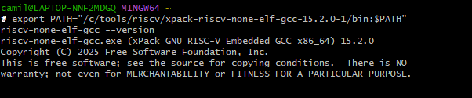
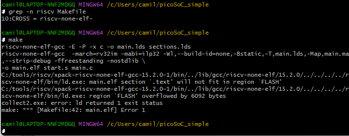
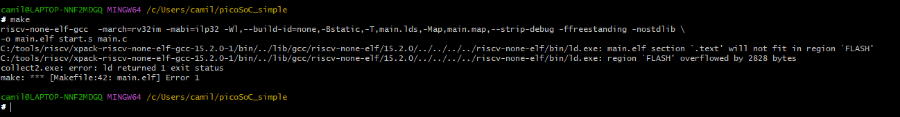
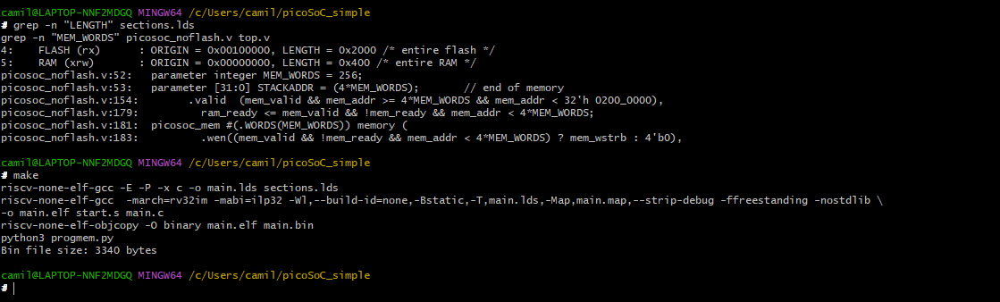
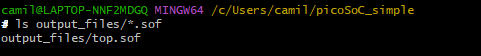
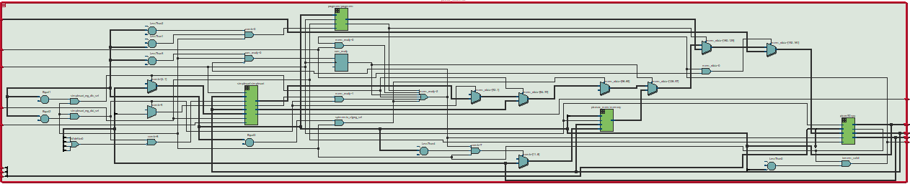
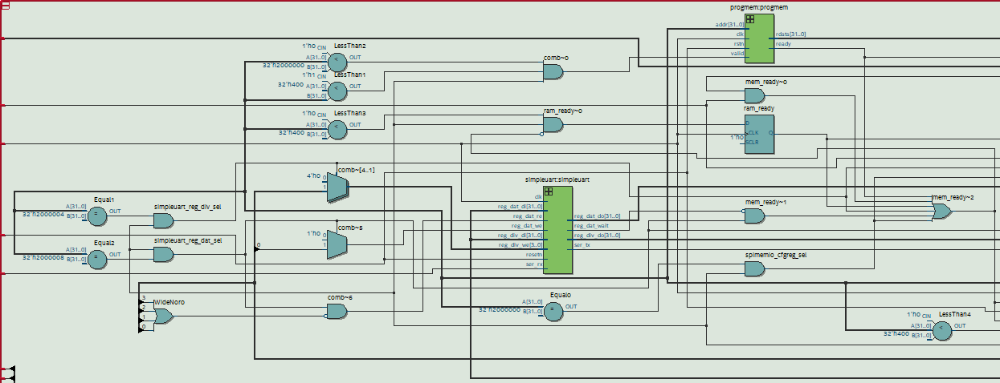
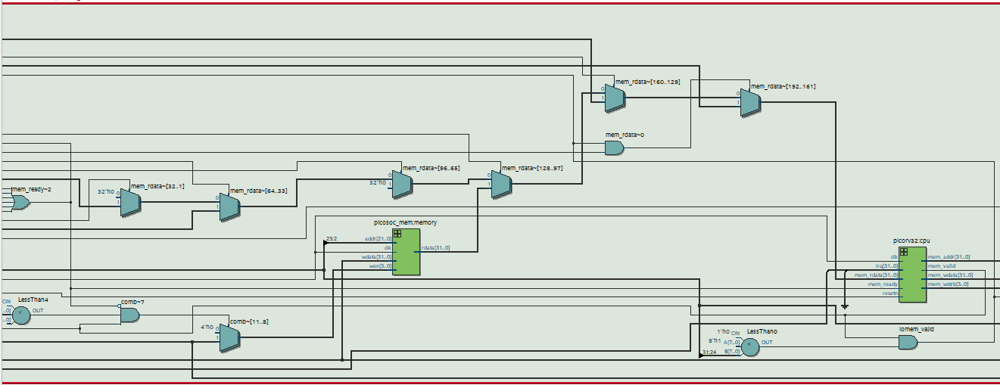
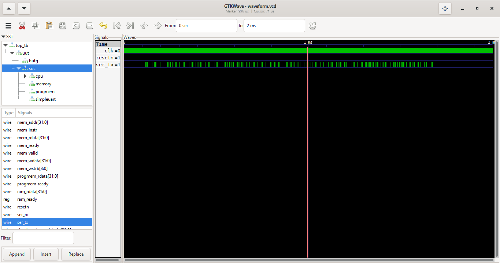
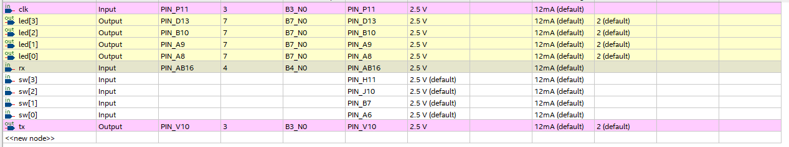

# picoSoC: consola de comandos por UART sobre PicoRV32 (FPGA MAX 10)

**Autor:** Luis Camilo Cuervo León · Código 130101 · Universidad ECCI · Noviembre de 2026

SoC basado en RISC-V (núcleo **PicoRV32**) para la FPGA Intel **MAX 10** de la DE10-Lite, con un firmware en C que ofrece una **consola de comandos por UART**: desde un terminal serie (PuTTY) se escriben comandos, el procesador los interpreta y actúa sobre los LEDs y los switches.

> **Estado de la verificación:** el diseño sintetiza sin errores en Quartus y el firmware responde a todos los comandos de la versión base **en simulación**. 

## Contenido

- [1. Estructura del repositorio](#1-estructura-del-repositorio)
- [2. Herramientas](#2-herramientas)
- [3. Arquitectura del SoC](#3-arquitectura-del-soc)
- [4. Firmware y comandos](#4-firmware-y-comandos)
- [5. Cómo compilar, simular y programar](#5-cómo-compilar-simular-y-programar)
- [6. Problemas encontrados y soluciones](#6-problemas-encontrados-y-soluciones)
- [7. Resultados de la síntesis](#7-resultados-de-la-síntesis)
- [8. Diagrama RTL](#8-diagrama-rtl)
- [9. Simulación en Verilog](#9-simulación-en-verilog)
- [10. Variantes con switches y botones](#10-variantes-con-switches-y-botones)
- [11. Asignación de pines](#11-asignación-de-pines)
- [12. Prueba en hardware (pendiente)](#12-prueba-en-hardware-pendiente)
- [13. Conclusiones](#13-conclusiones)

## 1. Estructura del repositorio

Base: [`picoSoC_simple`](https://github.com/digital-ECCI/picoSoC_simple) (Universidad ECCI). Archivos propios o modificados:

| Archivo | Descripción |
|---|---|
| `main.c` | Firmware con la consola de comandos (versión actual, con botones KEY0/KEY1) |
| `top.v` | Módulo principal (versión actual, con entrada `key[1:0]`) |
| `tb_consola.v` | Testbench que teclea comandos por UART y muestra las respuestas |
| `sections.lds` | **Modificado:** `FLASH` 4 KB y `RAM` 1 KB |
| `picosoc_noflash.v` | **Modificado:** `MEM_WORDS = 256` |
| `version_base/` | `main.c`, `top.v` y `tb_consola.v` de la versión **sin botones** (con aviso automático al mover los switches y el `top.v` original) |
| `docs/` | Capturas del informe y salida de la simulación (`simulacion_consola.txt`) |

El resto de archivos (`picorv32.v`, `simpleuart.v`, `progmem.py`, `start.s`, `Makefile`, etc.) son los del repositorio base, sin cambios.


*Figura 1. Carpeta del proyecto `picoSoC_simple` con los archivos del repositorio y los entregables.*

## 2. Herramientas

- **Intel Quartus Prime Lite 22.1std.1:** síntesis, colocación y rutado, bitstream y RTL Viewer.
- **MSYS2 (terminal MinGW 64-bit):** `make`, `git` y `python3`.
- **xPack GNU RISC-V Embedded GCC 15.2.0** (`riscv-none-elf-gcc`) en `C:/tools/riscv`.
- **Icarus Verilog y GTKWave:** simulación y formas de onda.
- **PuTTY 0.85:** terminal serie para la prueba en hardware.
- **Tarjeta objetivo:** DE10-Lite, FPGA `10M50DAF484C7G`.



*Figura 2. Compilador RISC-V respondiendo en la terminal MinGW 64-bit.*

## 3. Arquitectura del SoC

| Bloque | Descripción |
|---|---|
| **PicoRV32** (`picorv32:cpu`) | Procesador RV32IM; multiplicación y división por hardware (`picorv32_pcpi_mul` y `picorv32_pcpi_div` en el log de síntesis) |
| **ROM** (`progmem`) | 1024 palabras de 32 bits (4 KB) con el firmware, generada por `progmem.py` desde `main.bin` |
| **RAM** (`picosoc_mem:memory`) | 1 KB en `0x00000000`; la pila está al final |
| **UART** (`simpleuart`) | 115200 baudios; divisor 434 (50 MHz ÷ 115200) |
| **E/S** (`top.v`) | Registros mapeados en memoria para LEDs y switches, y reset de encendido (contador de 6 bits) |

**Mapa de memoria de periféricos:**

| Registro | Dirección | Acceso | Descripción |
|---|---|---|---|
| `REG_UART_CLK` | `0x02000004` | R/W | Divisor de reloj de la UART |
| `REG_UART_DATA` | `0x02000008` | R/W | Escritura: transmite; lectura: byte recibido o `-1` si no hay dato |
| `REG_LEDS` | `0x03000000` | R/W | Bits [3:0] = LED0..LED3 |
| `REG_SWITCHES` | `0x03000004` | R | Bits [3:0] = SW0..SW3 |
| `REG_KEYS` | `0x03000008` | R | Solo en la versión con botones: bit0 = KEY0, bit1 = KEY1 (1 = presionado) |

El procesador solo pone una dirección en el bus; la lógica de decodificación decide a qué bloque va el acceso (entrada/salida mapeada en memoria).

## 4. Firmware y comandos

`main.c` es un intérprete sin sistema operativo ni librería estándar: muestra el prompt `>`, lee una línea (con eco y borrado), la divide en palabras y ejecuta el comando.

| Comando | Descripción | Ejemplo |
|---|---|---|
| `help` | Lista los comandos | `help` |
| `led <n> <on\|off>` | Enciende/apaga el LED `n` (0-3) sin alterar los demás | `led 3 on` → `ok` |
| `leds <valor>` | Valor en los LEDs (decimal 0-15 o hex `0x0`-`0xF`) | `leds 0xA` → `LEDs = 0b1010` |
| `sw` | Lee los switches | `sw` → `switches = 0b0101` |
| `calc <a> <op> <b>` | `+ - * /` con enteros | `calc 6 * 7` → `6 * 7 = 42` |
| `blink <n> <veces>` | Parpadea el LED `n` (1-20 veces) y restaura el estado | `blink 2 5` |
| `knight [ciclos]` | **Comando propio:** "auto fantástico", un LED recorre 0-1-2-3-2-1; cualquier tecla lo detiene | `knight 3` |

**Decisiones de diseño:**

- Periféricos con punteros `volatile` a direcciones fijas.
- `led_state` guarda una copia de los LEDs: `led` cambia un solo bit (`| (1 << n)` para encender, `& ~(1 << n)` para apagar).
- El eco lo genera el firmware (`readline`), no PuTTY.
- `uart_getchar_nb()` es no bloqueante (devuelve `-1` si no hay dato); `knight` la usa para detenerse con una tecla.
- `#pragma GCC optimize ("Os")` para optimizar tamaño aunque el `Makefile` no lo pida.
- Todos los comandos validan argumentos y responden con un mensaje de uso en lugar de fallar.

## 5. Cómo compilar, simular y programar

En la terminal **MSYS2 MinGW 64-bit**, dentro de la carpeta del proyecto (el `PATH` hay que repetirlo en cada terminal nueva):

```bash
export PATH="/c/tools/riscv/xpack-riscv-none-elf-gcc-15.2.0-1/bin:$PATH"
export PATH=/c/intelFPGA_lite/22.1std/quartus/bin64:$PATH

make                        # main.c -> main.bin -> progmem.v
make build TARGET=max10     # quartus_map, quartus_fit, quartus_asm -> output_files/top.sof
make program TARGET=max10   # carga el .sof en la FPGA (requiere la tarjeta)
```

**Simulación** (necesita `progmem.v`, generado por `make`):

```bash
iverilog -o sim_consola tb_consola.v top.v picosoc_noflash.v picorv32.v simpleuart.v progmem.v
vvp sim_consola
gtkwave consola.vcd
```

Para probar también `blink` y `knight` (la simulación tarda mucho más): `iverilog -DPROBAR_LENTOS ...`.

Como el firmware vive dentro de la ROM del hardware, **cada cambio en `main.c` exige repetir `make` y `make build`** para obtener un `top.sof` nuevo. El `.sof` se pierde al apagar la placa.

## 6. Problemas encontrados y soluciones

### 6.1 Memoria insuficiente

La primera compilación falló con `region 'FLASH' overflowed by 6092 bytes`. El proyecto base definía solo **512 bytes** de programa (`LENGTH = 0x200`) y **128 bytes** de RAM (`LENGTH = 0x80`, `MEM_WORDS = 32`), y el firmware ocupa unos 3,3 KB.



*Figura 3. Primer error: `region 'FLASH' overflowed by 6092 bytes`.*

Al optimizar por tamaño con el pragma, el desbordamiento bajó a 2828 bytes, pero seguía sin caber:



*Figura 4. Tras optimizar tamaño: 2828 bytes de sobra.*

**Solución:** ampliar las memorias manteniendo coherentes software y hardware.

| Archivo | Cambio |
|---|---|
| `sections.lds` | `FLASH`: `0x200` → `0x1000` (4 KB, igual a la ROM de `progmem.py`); `RAM`: `0x80` → `0x400` (1 KB) |
| `picosoc_noflash.v` | `MEM_WORDS`: `32` → `256` (256 × 4 B = 1 KB; también fija `STACKADDR = 4*MEM_WORDS`) |



*Figura 5. Primera ampliación (FLASH `0x2000`, RAM `0x400`) y compilación con 3340 bytes. Después FLASH se ajustó a `0x1000` para igualar los 4 KB de la ROM generada.*

El cambio se confirma en el RTL: los comparadores de la RAM usan `32'h400` (Figura 8).

### 6.2 Entorno de desarrollo

- Se usó la terminal **MinGW 64-bit** de MSYS2 (no UCRT64); los paquetes de la guía son de MinGW.
- Quartus y el compilador RISC-V deben agregarse al `PATH` en cada terminal; la instalación encontrada fue Quartus 22.1std.
- Un error de tipeo (`TARGET=max10~`) hizo que `make program` usara el objetivo por defecto (una placa Arty con `openocd`).
- Icarus Verilog se instaló desde el paquete de UCRT64 de MSYS2.

### 6.3 Detección del prompt en el testbench

Al inicio, varios comandos se perdían: el testbench tomaba como prompt cualquier `>` seguido de un espacio, y esa secuencia también aparece en el texto de `help`. Se corrigió exigiendo que el `>` esté al inicio de línea.

## 7. Resultados de la síntesis

La síntesis terminó **sin errores**: Analysis & Synthesis (1 min 24 s), Fitter (3 min 38 s) y Assembler (7 s). Dispositivo: `10M50DAF484C7G`. Se implementaron 21 123 celdas lógicas y 64 segmentos de RAM, y se generó `output_files/top.sof`.



*Figura 6. Bitstream `output_files/top.sof`.*

Avisos relevantes:

- Cuatro pines de entrada sin ubicación asignada (los switches).
- No se encontró `top.sdc` (el repositorio incluye `picosoc.sdc`): sin restricciones de tiempo, no afecta la funcionalidad.
- La mayoría de los demás avisos provienen del código original de `picorv32.v`.

## 8. Diagrama RTL

Generado con *Tools → Netlist Viewers → RTL Viewer*.



*Figura 7. Vista general del RTL del SoC (`picosoc_noflash`).*



*Figura 8. `progmem`, `simpleuart` y los comparadores de dirección (`32'h02000004`, `32'h02000008`, `32'h400`).*



*Figura 9. Procesador `picorv32:cpu` y RAM `picosoc_mem:memory`.*

El resto de la lógica (comparadores, multiplexores y compuertas) decide a qué módulo corresponde cada acceso según la dirección y selecciona de dónde vuelve el dato de lectura.

## 9. Simulación en Verilog

`tb_consola.v` instancia `top`, genera el reloj de 50 MHz, **teclea comandos por `rx`** a 115200 baudios (divisor 434), decodifica `tx` y muestra en la terminal lo que imprime el firmware; además registra los cambios de los LEDs y genera `consola.vcd`.

Las formas de onda muestran que, tras el reset, el procesador arranca, ejecuta el firmware desde la ROM y transmite el banner por `ser_tx`:



*Figura 10. GTKWave (2 ms): el SoC sale de reset y transmite el banner por `ser_tx`.*

Resultado de la simulación de la versión base (salida completa en [`docs/simulacion_consola.txt`](docs/simulacion_consola.txt)):

| Comando | Resultado |
|---|---|
| `help` | Lista los comandos |
| `led 1 on`, `led 3 on`, `led 1 off` | `ok`; LEDs `0010` → `1010` → `1000` |
| `leds 0xA` | `LEDs = 0b1010`; LEDs `1010` |
| `sw` (con `sw = 0101`) | `switches = 0b0101` |
| `calc 6 * 7` | `6 * 7 = 42` |
| `calc 100 / 7` | `100 / 7 = 14` |
| `calc 5 / 0` | `division por cero` |
| `led 9 on` | `uso: led <0-3> <on\|off>` |
| `hola` | `comando desconocido (help)` |

## 10. Variantes con switches y botones

- **Aviso automático (`version_base/`):** mientras la consola espera un comando, el firmware vigila los switches y, al cambiar (con antirrebote), imprime `sw = 0bXXXX (n)`. No requiere cambios de hardware.
- **Botones KEY0 y KEY1 (raíz del repositorio):** `top.v` agrega la entrada `key[1:0]` (sincronizada con el reloj) y el registro `0x03000008`. **KEY0** lee los switches, los muestra en los LEDs y envía el resultado por la UART; **KEY1** pone a cero el contador de reset y reinicia todo el SoC. Pines previstos: `B8` y `A7` (a confirmar con el manual).

Ambas compilan (el firmware actual ocupa 3608 de los 4096 bytes disponibles), pero **su verificación en simulación o en hardware no está registrada**. La simulación de la sección 9 se ejecutó con los comandos base, antes de agregar el aviso de switches y los botones; esa es la evidencia con la que cuenta este repositorio.

## 11. Asignación de pines



*Figura 11. Pin Planner: los switches aparecen sin ubicación asignada.*

| Señal | Pin |
|---|---|
| `clk` | `P11` |
| `led[0]` a `led[3]` | `A8`, `A9`, `B10`, `D13` |
| `rx`, `tx` | `AB16`, `V10` |
| `sw[3:0]` | **Sin asignar** (Quartus les dio `H11`, `J10`, `B7`, `A6`) |

Antes de probar en la tarjeta hay que asignar los switches (`C10`, `C11`, `D12` y `C12` en la DE10-Lite, **a confirmar con el manual**), y conviene revisar `led[2]` y `led[3]` si se quieren cuatro LEDs contiguos.

## 12. Prueba en hardware (pendiente)

Para realizarla se requiere:

- La **DE10-Lite** y su cable USB (USB-Blaster) para cargar `top.sof`.
- Un **adaptador USB-serial de 3,3 V** (la placa no trae puerto serie por USB): RX del adaptador a `tx` (`V10`), TX del adaptador a `rx` (`AB16`) y masa común.
- **PuTTY** en modo Serial: puerto COM del adaptador, 115200 baudios, 8 bits, 1 de parada, sin paridad ni control de flujo.

Procedimiento: asignar los pines de los switches, `make`, `make build TARGET=max10`, `make program TARGET=max10`, abrir PuTTY y probar `help`, `led 1 on`, `sw`, `calc 6 * 7`, `blink 0 3` y `knight 2`, registrando video y fotos.

## 13. Conclusiones

- Se construyó un SoC funcional con PicoRV32, ROM, RAM, UART y periféricos de E/S, y un firmware en C con los comandos pedidos y un comando propio.
- El problema principal fue la capacidad de memoria (512 B de programa y 128 B de RAM frente a un firmware de ~3,3 KB); se resolvió ampliando de forma coherente `sections.lds` y `MEM_WORDS`, y se verificó en el RTL.
- La síntesis en Quartus terminó sin errores y generó `top.sof`.
- La simulación mostró el firmware ejecutándose sobre el procesador y respondiendo correctamente a todos los comandos de la versión base.
- Quedan pendientes la asignación de pines de los switches y la prueba en la tarjeta.
